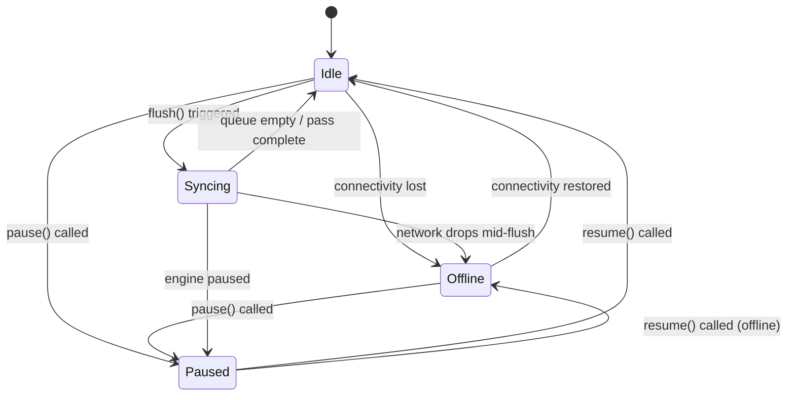

# System Architecture & Design Philosophy

`sync_orbit` is designed for applications that must operate reliably in zero-connectivity or degraded network environments without data loss, while preserving causal consistency and predictable synchronization behavior.

---

## 1. The Transactional Outbox Pattern

In traditional mobile architectures, data modifications are dispatched directly over the network:

```
[UI Component] ───HTTP Request───> [Remote API]
```

If the device drops connectivity mid-flight, this approach introduces severe failure modes:
1. **Lost Writes**: If the user backgrounds the app or loses signal before the network request succeeds, the intent is lost.
2. **Ghost Duplications**: If the server processed the write but the acknowledgment packet dropped, a naive user retry creates duplicate entries.
3. **Out-of-Order Execution**: If request A times out and is retried *after* request B succeeds, downstream mutations execute out of causal sequence.

`sync_orbit` eliminates these problems using the **Transactional Outbox Pattern**:

```
[User Action] ──> [Local Database (UI State)]
       │
       └──> [Outbox Queue (SyncMutation)] ──FIFO──> [SyncEngine] ──> [Remote Backend]
```

1. **Immediate Local Mutation**: The user's action immediately updates the local database and records a `SyncMutation` inside the outbox queue in a single atomic transaction.
2. **Decoupled Dispatch**: The UI continues rendering immediately with zero network latency.
3. **Guaranteed Delivery**: The `SyncEngine` reads mutations in strict chronological order and dispatches them sequentially.

---

## 2. Engine State Machine

The `SyncEngine` operates on a deterministic finite state machine (FSM):



### State Definitions
- **`SyncEngineState.idle`**: The queue is initialized and monitored. No flush pass is currently executing.
- **`SyncEngineState.syncing`**: An active flush cycle is sequentially dispatching pending mutations to the remote adapter.
- **`SyncEngineState.offline`**: Injected connectivity reported that the device has no internet connection. Outbox queuing continues locally, but network dispatch is suspended.
- **`SyncEngineState.paused`**: The application explicitly halted synchronization (e.g. user toggled "Data Saver", or an authentication flow is renewing credentials).

---

## 3. Strict First-In-First-Out (FIFO) & Causal Ordering

Mutations within a distributed system often have causal dependencies:
1. `CREATE /orders/101`
2. `UPDATE /orders/101` (status = "paid")
3. `POST /shipments` (orderId = 101)

If `CREATE` fails due to a temporary 503 gateway error, continuing to dispatch `UPDATE` or `POST` causes cascading failures.

### Causal Halting on Recoverable Failures
When `SyncEngine` encounters a recoverable error (such as a timeout, socket failure, or HTTP 5xx error):
1. The failing mutation is updated with `retryCount += 1`, `lastError`, and `status = failed`.
2. **The current flush batch is immediately halted.**
3. Subsequent dependent mutations in the queue remain untouched in `pending` status.
4. The engine computes the next retry window via `RetryPolicy` exponential backoff.

---

## 4. Concurrency & Mutex Protection

In Flutter applications, flush triggers frequently collide:
- The device transitions from cellular to Wi-Fi (`connectivityStream`).
- The user enqueues a new item (`autoFlushOnEnqueue: true`).
- A periodic background timer triggers (`workmanager`).

To avoid race conditions, duplicate dispatches, or out-of-order execution, `SyncEngine` enforces an **asynchronous mutex gate**:

```dart
Future<SyncFlushResult> flush() {
  if (_activeFlush != null) {
    // Return existing in-flight future rather than starting a duplicate pass
    return _activeFlush!;
  }
  
  // Create completer and lock execution
  final completer = Completer<SyncFlushResult>();
  _activeFlush = completer.future;
  
  // Execute sequential loop and unlock on completion
  ...
}
```

Any subsequent call to `flush()` while a flush is in progress will safely join and await the active pass.

---

## 5. Event Stream Architecture

The engine exposes broadcast streams allowing the UI to remain reactive without tight coupling:

| Event | Description | Recommended UI Reaction |
|---|---|---|
| `MutationQueuedEvent` | Mutation recorded to local outbox. | Show optimistic checkmark or "Saved locally" badge. |
| `MutationSyncStartedEvent` | In-flight dispatch initiated. | Show spinning sync icon on record. |
| `MutationSyncedEvent` | Acknowledged by remote backend. | Remove local pending indicator; update remote ID. |
| `MutationConflictResolvedEvent` | Conflict resolved by policy. | Update UI with merged or server-authoritative record. |
| `MutationFailedEvent` | Mutation failed during execution. | Display retry badge or alert if permanently dead-lettered. |
| `SyncFlushCompletedEvent` | Batch cycle finished. | Refresh outbox counter or update last synced timestamp. |
